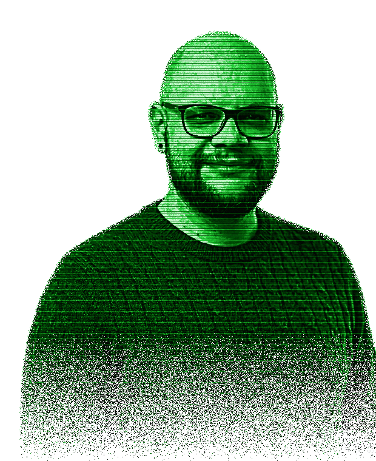

  

<h1 align="center">👋 Hi there, I’m Joshua</h1>

  Engineer from Germany · PCBs, embedded firmware, apps &amp; software

  
  
  

---

I enjoy the full journey of a product: from the first sketch of a circuit, through the board layout and the
firmware, all the way to the app in the store. With **MrJSA Technologies** I build my own products and help
others bring theirs to life.

**Languages:** Rust, Kotlin, anything C (C, C++, C#)

## Working on

- **[mrjsa.com](https://github.com/MrJSA/MrJSAWebsite)** · my website, SvelteKit + a tiny Rust server
- **[RustCraft](https://github.com/MrJSA/RustCraft)** · the shop behind [shop.mrjsa.com](https://shop.mrjsa.com)
- Some mods for different consoles

> Development is like farting — it turns to shit if you force it.
